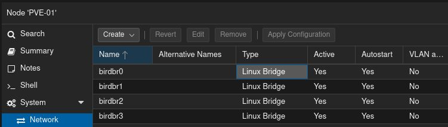
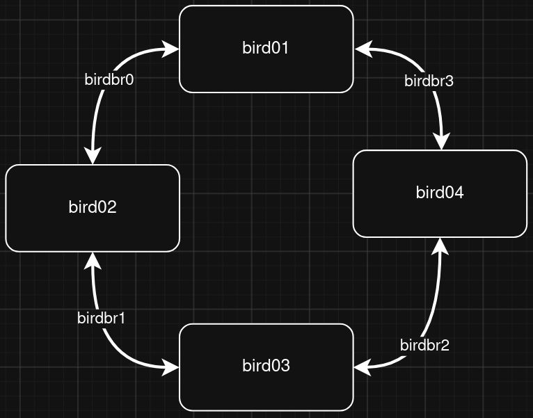
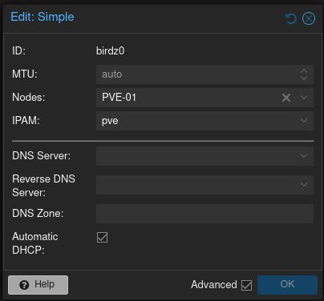
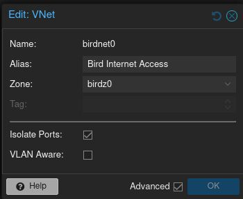
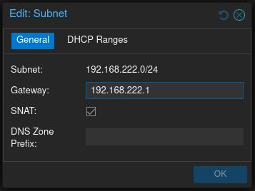
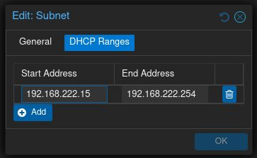

---
{"dg-publish":true,"permalink":"/home-lab/bird-lab/","tags":["LAB"],"dg-note-properties":{"tags":["LAB"]}}
---

# ==WORK IN PROGRESS==
BIRD lab and testing project. The goal here is to learn how to use BIRD by setting up a network with multiple BIRD nodes and configuring them to talk to each other. I'm going to start out simple with RIP and IPv4, once that's working i'll give it a shot with IPv6, finally Ill try to get BGP going with IPv6.

# Starting out simple with RIP and IPv4
To begin with i'm going to do a 4 node network
## VM Config
Each VM will be running NixOS and will have 2 CPU cores and 4GB of RAM.

| VM ID | VM Name | nic0     | nic1    | nic2    | FQDN                       |
| ----- | ------- | -------- | ------- | ------- | -------------------------- |
| 301   | bird01  | birdnet0 | birdbr0 | birdbr3 | bird01.corp.strand.systems |
| 302   | bird02  | birdnet0 | birdbr0 | birdbr1 | bird02.corp.strand.systems |
| 303   | bird03  | birdnet0 | birdbr1 | birdbr2 | bird03.corp.strand.systems |
| 304   | bird04  | birdnet0 | birdbr2 | birdbr3 | bird04.corp.strand.systems |
VM IP Addresses configuration

| VM Name | nic0 IP | nic1 IP   | nic2 IP   |
| ------- | ------- | --------- | --------- |
| bird01  | DHCP    | 10.0.12.1 | 10.0.41.2 |
| bird02  | DHCP    | 10.0.12.2 | 10.0.23.1 |
| bird03  | DHCP    | 10.0.23.2 | 10.0.34.1 |
| bird04  | DHCP    | 10.0.34.2 | 10.0.41.1 |

## Network Configuration
To configure direct network connections between each VM in proxmox I added a few Linux Bridges with no physical NIC assigned to the PVE node that will be running the VMs. I also created a SDN network to allow the VMs to have internet access while also not allowing them to see each other through that network.

To set up the Linux Bridges I went to PVE-01 > System > Network and created 4 Linux Bridges named from birdbr0 to birdbr3

Here is what the network topology will be for this first simple test with RIP and IPv4

To configure the SDN network I first went to Datacenter > SDN > Zones and added a new simple Zone called `birdz0` and made sure to enable Automatic DHCP. 
Next I went to Datacenter > SDN > VNets and created a new VNet called `birdnet0`. I made sure to check Isolate Ports so the VMs wont be able to see each other on this network.

Finally I added a Subnet withing the `birdnet0` VNet. I enabled SNAT to allow VMs within this subnet internet access and configured a DHCP range for this subnet.

Once all changes were made I went to Datacenter > SDN and clicked Apply to make the changes usable.
### Detour!!
After the proxmox SDN was configured hosts within the 192.168.222.0/24 subnet could make connections out to the LAB subnet (192.168.7.0/24) but the LAB subnet couldn't make connections into the 192.168.222.0/24 subnet. After a bit of investigation I saw that the traffic from the LAB subnet was being routed out through the default gateway instead of to proxmox. 

To fix this I tried adding a static route on the OPNsense router, which initially seemed to work however connections would drop after 20 to 30 seconds. Next I removed the static route from OPNsense and instead added a static route to my laptop with the command `ip route add 192.168.222.0/24 via 192.168.7.142`. After I added the static route to my laptop I could connect to hosts inside the 192.168.7.222/24 subnet just fine from my laptop.
